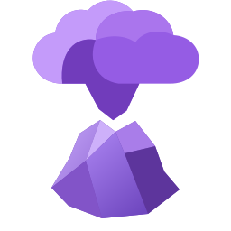

#  Tephra

Tephra is a self-hosted, web-based [Obsidian](https://obsidian.md) client. Your local vault stays the source of truth; Tephra syncs it to a server you run, so you can read and edit your notes from any browser. Wikilinks, backlinks, attachments, and the graph all work, and edits made on the web flow back into your vault.

> [!NOTE]
> Tephra is an independent project and is not officially affiliated with or endorsed by Obsidian.

It is built for one person on one box: a single container on your own domain, whether that's Railway, EC2, or any VM you control.

## Set up

1. **Deploy a server** (see below) and keep the `TEPHRA_BOOTSTRAP_TOKEN` you start it with.
2. **Create your account and a vault** in the web app, then create an upload token for that vault.
3. **Install the plugin** in Obsidian. The easiest route, on desktop and mobile, is [BRAT](docs/INSTALL_PLUGIN_BRAT.md), which installs it straight from this repo.
4. **Connect it:** paste the server URL, vault ID, and token into the plugin settings and click **Sync now**.

[Getting Started](docs/GETTING_STARTED.md) covers each step in detail.

## Deploy

<p>
  <a href="docs/deploy/RAILWAY.md"></a>
  <a href="https://shell.cloud.google.com/cloudshell/open?cloudshell_git_repo=https%3A%2F%2Fgithub.com%2Fchampionswimmer%2Ftephra.git&amp;cloudshell_workspace=.&amp;cloudshell_open_in_editor=docs%2Fdeploy%2FGCP.md"></a>
  <a href="docs/deploy/AWS.md#one-click-cloudformation"></a>
  <a href="docs/deploy/DO.md"></a>
</p>

Each button opens a guide or a prefilled shell rather than deploying blindly: Tephra needs a persistent disk and exactly one instance, so one-click Cloud Run or App Platform buttons don't fit. See [`docs/deploy/`](docs/deploy/) for all guides.

## Good to know

- Notes are addressed by vault-relative path (`/#/path/to/note.md`), so links are shareable and behave the same on macOS, Linux, and Windows.
- A web edit creates a server revision that the plugin pulls into your vault. If a note changed in both places, the newest write wins and the other version is kept as a conflicted copy.
- The plugin remembers which note is which across renames using one of three [identity modes](tephra-plugin/README.md#behavior-and-privacy). The default sidecar mode never modifies your notes.
- Vaults are private, plugin tokens are scoped to one vault, blobs are SHA-256 verified, and Markdown is sanitized before display. See the [threat model](docs/THREAT_MODEL.md).

## Roadmap

A browser-safe subset of community plugin support, and optional publishing of chosen parts of a vault.

## Repository

- [`tephra-server/`](tephra-server/): API, web app, shared packages, deployment assets.
- [`tephra-plugin/`](tephra-plugin/): the mobile-compatible Obsidian sync plugin.
- [Stage 1 plan](.agents/plans/001-TEPHRA_STAGE1_PLAN.md)

## Development

Requires Node.js 22+ and npm 10+.

```bash
npm install
npm run check
npm run dev
```

The product READMEs cover configuration and usage.

## License

AGPL-3.0-or-later. See [LICENSE](LICENSE).
