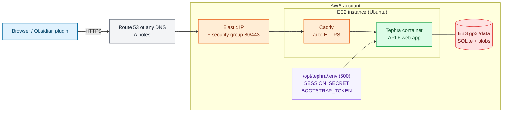

# Deploy Tephra on AWS

One EC2 instance + 20 GB EBS at `/data`, Docker Compose, Caddy for HTTPS.
(Managed alternative: ECS/Fargate + EFS in `tephra-server/deploy/aws/`.)

## Infra at a glance



Colors: blue = users, orange = network edge, green = compute, red = data, purple = secrets, gray = DNS/meta.

## One-click CloudFormation

[](https://console.aws.amazon.com/cloudformation/home#/stacks/create/review?stackName=tephra&templateURL=https%3A%2F%2Fs3.amazonaws.com%2FYOUR-BUCKET%2Ftephra.yaml)

Template: `tephra-server/deploy/aws/cloudformation.yaml` (EC2, encrypted EBS, Elastic IP; secrets generated in Secrets Manager, never in user-data). CloudFormation only accepts S3 template URLs, so either:

```sh
# A) no hosting needed
aws cloudformation deploy --stack-name tephra --capabilities CAPABILITY_IAM \
  --template-file tephra-server/deploy/aws/cloudformation.yaml \
  --parameter-overrides DomainName=notes.example.com

# B) host once, then the button above works (replace YOUR-BUCKET in its URL)
aws s3 cp tephra-server/deploy/aws/cloudformation.yaml s3://YOUR-BUCKET/tephra.yaml
```

Then: point `A notes.example.com` at the `ElasticIp` output, run the `BootstrapTokenCommand` output to get the setup token, and open `/setup`.

## Quick: one command

```sh
DOMAIN=notes.example.com HOSTED_ZONE_ID=Z123 scripts/deploy/aws.sh
```

`HOSTED_ZONE_ID` and `REGION` (default `us-east-1`) are optional. Skip to step 5.

## Manual

1. Launch Ubuntu 24.04, `t3.small`, add a 20 GB gp3 EBS volume.
2. Security group: inbound TCP 80 and 443 only. No SSH.
3. Allocate an Elastic IP and attach it to the instance.
4. DNS: `A notes.example.com -> <Elastic IP>` (Route 53 or any DNS).
5. Secrets (never commit, never paste in chat):
   ```sh
   openssl rand -hex 32   # TEPHRA_SESSION_SECRET
   openssl rand -hex 24   # TEPHRA_BOOTSTRAP_TOKEN
   ```
   Keep them in `/opt/tephra/.env` (`chmod 600`). Prefer SSM Parameter Store SecureString if you use an instance role.
6. Set `TEPHRA_PUBLIC_URL=https://notes.example.com` in the same file.
7. Mount EBS at `/data`, build the image, run compose (see user-data in the script).
8. Open `https://notes.example.com/setup`, create the first user with the bootstrap token.
9. Remove `TEPHRA_BOOTSTRAP_TOKEN` from `.env` / SSM, then `docker compose up -d`.

## Notes

- Back up by snapshotting the EBS volume. Keep one instance only (SQLite).
- Logs: `docker compose logs -f` in `/opt/tephra`.
