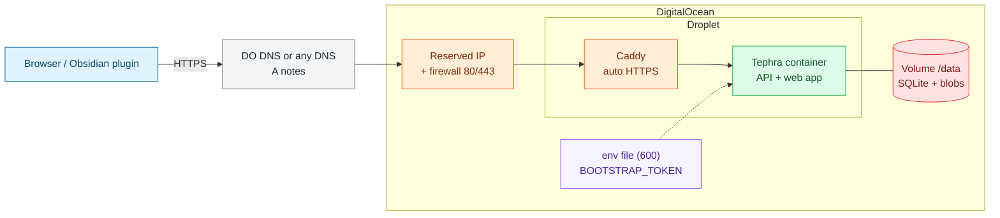

# Deploy on DigitalOcean

[](https://cloud.digitalocean.com/droplets/new)

One Droplet + one Volume (`/data`) + Reserved IP, running Docker Compose with Caddy (auto HTTPS).
App Platform is not suitable: it has no persistent disk (Tephra needs SQLite + blobs on disk).

## Infra at a glance



Colors: blue = users, orange = network edge, green = compute, red = data, purple = secrets, gray = DNS/meta.

## Quick way

```bash
doctl auth init
DOMAIN=notes.yourname.com REGION=nyc3 ./scripts/deploy/do.sh
```

Set `DNS_ZONE=yourname.com` to also create the A record (domain must be in DO DNS).

## Manual steps

1. Create a 10 GiB Volume and an Ubuntu 24.04 Droplet (2 GB RAM) in the same region.
2. Attach the Volume, format it once (`mkfs.ext4`), mount at `/data`, `chown 65532:65532 /data` (the default Go image runs as `nonroot`; use `1000:1000` if you build with `--build-arg WITH_OBSIDIAN_SYNC=true`).
3. Install Docker, clone the repo, build: `docker build -t tephra:local -f tephra-server/deploy/docker/Dockerfile.go .`
4. Generate secrets into a private env file:
   ```bash
   umask 077
   printf 'TEPHRA_BOOTSTRAP_TOKEN=%s\nTEPHRA_PUBLIC_URL=https://notes.yourname.com\n' \
     "$(openssl rand -hex 32)" > tephra.env   # chmod 600
   ```
5. Create a Reserved IP, assign it to the Droplet.
6. DNS: `A notes.yourname.com -> <reserved IP>` (DO DNS or any provider).
7. Run `docker compose --env-file tephra.env up -d` (Tephra on :8080, Caddy on :80/:443 proxying to it).

## First boot

1. Open `https://notes.yourname.com/setup` and create the owner account with the bootstrap token.
2. Delete `TEPHRA_BOOTSTRAP_TOKEN` from `tephra.env`, then `docker compose --env-file tephra.env up -d`.
3. Back up the Volume (enable DO snapshots).

## Environment variables

The deploy script generates the secrets and writes `/opt/tephra/tephra.env` (mode 600) on
the Droplet; Compose loads it with `--env-file`.

| Variable                 | Needed          | Value here                     | Purpose                                                     |
| ------------------------ | --------------- | ------------------------------ | ----------------------------------------------------------- |
| `TEPHRA_PUBLIC_URL`      | always          | `https://notes.yourname.com`   | Browser-visible origin for redirects, cookies and MCP OAuth |
| `TEPHRA_SESSION_SECRET`  | no              | may be generated by the script | Legacy; the Go server does not read it                      |
| `TEPHRA_BOOTSTRAP_TOKEN` | first boot only | generated, 32 random bytes     | Creates the first admin; delete it after setup              |
| `TEPHRA_SQLITE_PATH`     | no              | `/data/tephra.db`              | Database file on the Volume                                 |
| `TEPHRA_BLOB_PATH`       | no              | `/data/blobs`                  | Attachment store on the Volume                              |

Do not set `TEPHRA_DATABASE_DRIVER` or `TEPHRA_BLOB_DRIVER` to anything except `sqlite`
and `filesystem`. The complete list, including defaults, is in
[`tephra-server/README.md`](../../tephra-server/README.md#configuration).

After setup, remove the one-time token and restart:

```bash
ssh root@YOUR_IP "sed -i '/BOOTSTRAP_TOKEN/d' /opt/tephra/tephra.env && \
  cd /opt/tephra && docker compose --env-file tephra.env up -d"
```
