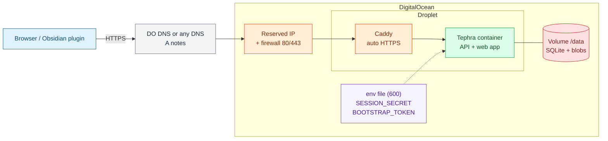

# Deploy on DigitalOcean

One Droplet + one Volume (`/data`) + Reserved IP, running Docker Compose with Caddy (auto HTTPS).
App Platform is not suitable: it has no persistent disk (Tephra needs SQLite + blobs on disk).

## Infra at a glance



Colors: blue = users, orange = network edge, green = compute, red = data, purple = secrets, gray = DNS/meta.

## Quick way

```bash
doctl auth init
DOMAIN=notes.example.com REGION=nyc3 ./scripts/deploy/do.sh
```

Set `DNS_ZONE=example.com` to also create the A record (domain must be in DO DNS).

## Manual steps

1. Create a 10 GiB Volume and an Ubuntu 24.04 Droplet (2 GB RAM) in the same region.
2. Attach the Volume, format it once (`mkfs.ext4`), mount at `/data`, `chown 1000:1000 /data`.
3. Install Docker, clone the repo, build: `docker build -t tephra:local -f tephra-server/deploy/docker/Dockerfile .`
4. Generate secrets into a private env file:
   ```bash
   umask 077
   printf 'TEPHRA_SESSION_SECRET=%s\nTEPHRA_BOOTSTRAP_TOKEN=%s\nTEPHRA_PUBLIC_URL=https://notes.example.com\n' \
     "$(openssl rand -hex 32)" "$(openssl rand -hex 32)" > tephra.env   # chmod 600
   ```
5. Create a Reserved IP, assign it to the Droplet.
6. DNS: `A notes.example.com -> <reserved IP>` (DO DNS or any provider).
7. Run `docker compose --env-file tephra.env up -d` (Tephra on :8080, Caddy on :80/:443 proxying to it).

## First boot

1. Open `https://notes.example.com/setup` and create the owner account with the bootstrap token.
2. Delete `TEPHRA_BOOTSTRAP_TOKEN` from `tephra.env`, then `docker compose --env-file tephra.env up -d`.
3. Back up the Volume (enable DO snapshots).
