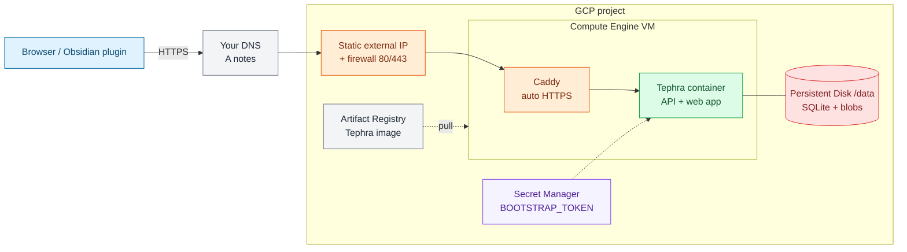

# Deploy Tephra on GCP

[](https://shell.cloud.google.com/cloudshell/open?cloudshell_git_repo=https%3A%2F%2Fgithub.com%2Fchampionswimmer%2Ftephra.git&cloudshell_workspace=.&cloudshell_open_in_editor=docs%2Fdeploy%2FGCP.md)

One Compute Engine VM + Persistent Disk running the Go server Docker image (`tephra-server/deploy/docker/Dockerfile.go`), Caddy for HTTPS, secrets in Secret Manager. (Cloud Run needs Filestore; see `tephra-server/deploy/gcp/README.md`.)

## Infra at a glance



Colors: blue = users, orange = network edge, green = compute, red = data, purple = secrets, gray = DNS/meta.

1. Open Cloud Shell with the button above (already logged in), or run `gcloud auth login`.
2. Run the script (it builds the image on the VM; set `IMAGE=...` to pull a prebuilt one):
   ```sh
   PROJECT=my-proj ZONE=us-central1-a DOMAIN=notes.yourname.com \
   scripts/deploy/gcp.sh
   ```
   It creates: static IP, firewall (80/443), 10 GB disk, the `TEPHRA_BOOTSTRAP_TOKEN` secret (random via `openssl rand -hex 32`; the script also creates a legacy `TEPHRA_SESSION_SECRET` that the Go server ignores), and the VM.
3. Add a DNS record at your registrar: `A notes.yourname.com -> <IP printed by script>`.
4. Wait ~5 min (first boot builds the image). Caddy gets the TLS cert; `TEPHRA_PUBLIC_URL=https://notes.yourname.com` is set for you.
5. Get the bootstrap token and open `https://notes.yourname.com/setup`:
   ```sh
   gcloud secrets versions access latest --secret=tephra-bootstrap-token
   ```
6. After setup, remove the token:
   ```sh
   gcloud compute ssh tephra --zone us-central1-a --command \
     "cd /opt/tephra && sudo sed -i '/BOOTSTRAP_TOKEN/d' tephra.env && sudo docker-compose up -d --force-recreate tephra"
   ```
7. Backup: `gcloud compute disks snapshot tephra-data --zone us-central1-a`.

## Environment variables

The deploy script creates the two secrets in Secret Manager and writes
`/opt/tephra/tephra.env` on the VM at first boot. Change a value with
`gcloud secrets versions add <secret> --data-file=-` (then restart the container) or by
editing `tephra.env`.

| Variable                 | Needed          | Value here                              | Purpose                                                     |
| ------------------------ | --------------- | --------------------------------------- | ----------------------------------------------------------- |
| `TEPHRA_PUBLIC_URL`      | always          | `https://notes.yourname.com`            | Browser-visible origin for redirects, cookies and MCP OAuth |
| `TEPHRA_SESSION_SECRET`  | no              | Secret Manager `tephra-session-secret`  | Legacy; the Go server does not read it                      |
| `TEPHRA_BOOTSTRAP_TOKEN` | first boot only | Secret Manager `tephra-bootstrap-token` | Creates the first admin; delete it after setup              |
| `TEPHRA_SQLITE_PATH`     | no              | `/data/tephra.db`                       | Database file on the Persistent Disk                        |
| `TEPHRA_BLOB_PATH`       | no              | `/data/blobs`                           | Attachment store on the Persistent Disk                     |

Do not set `TEPHRA_DATABASE_DRIVER` or `TEPHRA_BLOB_DRIVER` to anything except `sqlite`
and `filesystem`. The complete list, including defaults, is in
[`tephra-server/README.md`](../../tephra-server/README.md#configuration).

After setup, remove the line from `tephra.env`, restart the container, then delete the
one-time secret:

```sh
gcloud compute ssh tephra --zone us-central1-a --command \
  "cd /opt/tephra && sudo sed -i '/BOOTSTRAP_TOKEN/d' tephra.env && sudo docker-compose up -d --force-recreate tephra"
gcloud secrets delete tephra-bootstrap-token
```

Never attach one disk to two VMs.
