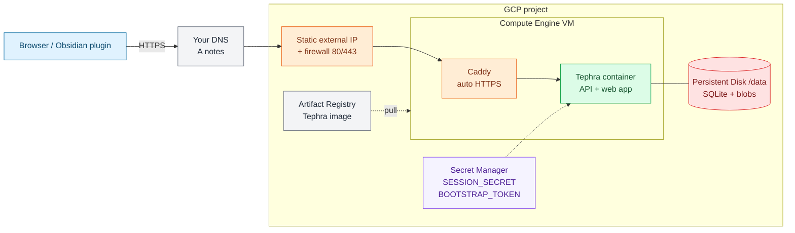

# Deploy Tephra on GCP

[](https://shell.cloud.google.com/cloudshell/open?cloudshell_git_repo=https%3A%2F%2Fgithub.com%2Fchampionswimmer%2Ftephra.git&cloudshell_workspace=.&cloudshell_open_in_editor=docs%2Fdeploy%2FGCP.md)

One Compute Engine VM + Persistent Disk running the Docker image, Caddy for HTTPS, secrets in Secret Manager. (Cloud Run needs Filestore; see `tephra-server/deploy/gcp/README.md`.)

## Infra at a glance



Colors: blue = users, orange = network edge, green = compute, red = data, purple = secrets, gray = DNS/meta.

1. Open Cloud Shell with the button above (already logged in), or run `gcloud auth login`.
2. Run the script (it builds the image on the VM; set `IMAGE=...` to pull a prebuilt one):
   ```sh
   PROJECT=my-proj ZONE=us-central1-a DOMAIN=notes.example.com \
   scripts/deploy/gcp.sh
   ```
   It creates: static IP, firewall (80/443), 10 GB disk, 2 secrets (`TEPHRA_SESSION_SECRET`, `TEPHRA_BOOTSTRAP_TOKEN`, random via `openssl rand -hex 32`), and the VM.
3. Add a DNS record at your registrar: `A notes.example.com -> <IP printed by script>`.
4. Wait ~5 min (first boot builds the image). Caddy gets the TLS cert; `TEPHRA_PUBLIC_URL=https://notes.example.com` is set for you.
5. Get the bootstrap token and open `https://notes.example.com/setup`:
   ```sh
   gcloud secrets versions access latest --secret=tephra-bootstrap-token
   ```
6. After setup, remove the token:
   ```sh
   gcloud compute ssh tephra --zone us-central1-a --command \
     "cd /opt/tephra && sudo sed -i '/BOOTSTRAP_TOKEN/d' tephra.env && sudo docker-compose up -d --force-recreate tephra"
   ```
7. Backup: `gcloud compute disks snapshot tephra-data --zone us-central1-a`.

Never attach one disk to two VMs.
