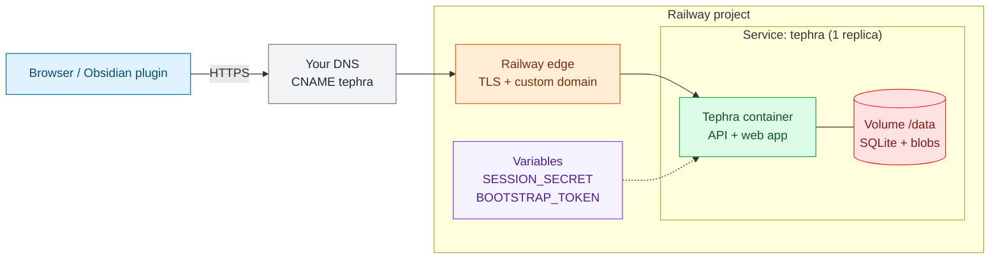

# Deploy Tephra on Railway

Needs: 1 service + 1 volume at `/data` + **1 replica** (SQLite). Defined in `.railway/railway.ts`.

## Infra at a glance



Colors: blue = users, orange = network edge, green = compute, red = data, purple = secrets, gray = DNS/meta.

1. Install the Railway CLI, then log in and link a project:

   ```bash
   railway login && railway link
   ```

2. Deploy from the repo root. This creates the service and volume, then generates the secrets once:

   ```bash
   npm run deploy:railway
   ```

3. Secrets (`TEPHRA_SESSION_SECRET`, `TEPHRA_BOOTSTRAP_TOKEN`) are set for you. To set them by hand:

   ```bash
   printf '%s' "$(openssl rand -hex 32)" | railway variable set TEPHRA_SESSION_SECRET --stdin --service tephra --skip-deploys
   printf '%s' "$(openssl rand -hex 32)" | railway variable set TEPHRA_BOOTSTRAP_TOKEN --stdin --service tephra
   ```

4. Custom subdomain: in Railway, Service > Settings > Networking > Custom Domain, add `tephra.example.com`. Add the CNAME it shows at your DNS provider:

   ```text
   tephra  CNAME  <value-from-railway>.up.railway.app
   ```

   Or set `domains: ["tephra.example.com"]` on the service in `.railway/railway.ts`.

5. Set the public URL, then redeploy:

   ```bash
   railway variable set TEPHRA_PUBLIC_URL=https://tephra.example.com --service tephra
   ```

   Note: re-running `deploy:railway` resets this to the Railway domain unless you edit `railway.ts`.

6. First boot: open `https://tephra.example.com/setup`, enter the bootstrap token, create your account.
7. Delete the one-time token:

   ```bash
   railway variable delete TEPHRA_BOOTSTRAP_TOKEN --service tephra
   ```

Details: `tephra-server/deploy/railway/README.md`.
